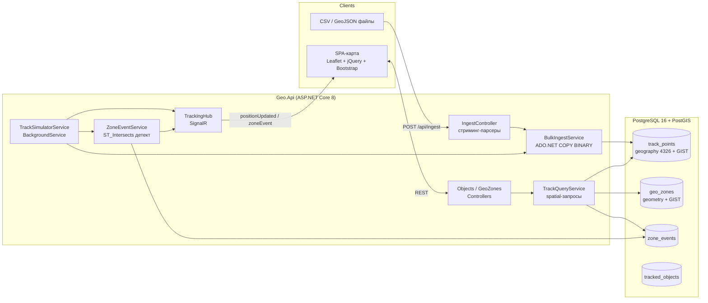

# GeoTracker

Геоинформационный трекинг-сервис: приём трековых точек (CSV/GeoJSON bulk-инжестия), хранение в PostgreSQL/PostGIS, пространственные запросы, геозоны с детектом входа/выхода, realtime-рассылка по SignalR и живая карта на Leaflet.

Пет-проект под стек: **C# / .NET 8, ASP.NET Core, SignalR, EF Core, ADO.NET (Npgsql COPY), PostgreSQL/PostGIS, NetTopologySuite, jQuery + Bootstrap + Leaflet, Docker, GeoServer (опционально)**.

## Запуск (одна команда)

```bash
docker compose up --build
```

- API + Swagger: http://localhost:8080/swagger
- Карта (SPA): http://localhost:8080/
- PostGIS: localhost:5432 (`geo`/`geo`, БД `geotracker`)

После старта миграции применяются автоматически, симулятор запускает 12 объектов, движущихся по Москве — маркеры на карте двигаются в реальном времени.

Бонус — GeoServer с WMS поверх того же PostGIS:

```bash
docker compose --profile bonus up --build
# UI GeoServer: http://localhost:8081/geoserver (admin/geoserver)
# Store: PostGIS → Host=db, db=geotracker, user=geo; опубликовать слой track_points в workspace "geotracker"
# На карте слой "Треки (GeoServer WMS)" уже преднастроен в переключателе слоёв
```

Локальная разработка без Docker для API:

```bash
docker compose up db          # только БД
dotnet run --project src/Geo.Api
```

## Архитектура



Решение разделено на 3 проекта:

- **Geo.Domain** — сущности: `TrackedObject`, `TrackPoint` (geography Point 4326), `GeoZone` (geometry Polygon), `ZoneEvent`.
- **Geo.Infrastructure** — `GeoDbContext` (EF Core + Npgsql + NetTopologySuite), миграции, snake_case naming, GIST-индексы.
- **Geo.Api** — контроллеры, сервисы, хаб, симулятор, статический фронт (`wwwroot/index.html`).

## Ключевые возможности

### Высокопроизводительная инжестия (визитная карточка)

- `POST /api/ingest/csv?objectId=…` и `POST /api/ingest/geojson?objectId=…` — raw body или multipart.
- **Стриминг**: `StreamReader` построчно / `Utf8JsonReader` с буфером 32 КБ — файл не загружается в память, потребление О(1) от размера файла.
- **Bulk-вставка**: чистый ADO.NET — `COPY track_points (...) FROM STDIN (FORMAT BINARY)` батчами по 20 000 строк.
- Замер throughput (`Stopwatch`) возвращается в ответе и пишется в лог: `{ inserted, rejected, elapsedMs, rowsPerSecond }`.

Ориентировочная производительность: ~300–500 тыс. строк/с на типовой машине (замерьте на своей — генератор ниже).

Генератор тестовых данных (CSV на 1 млн точек):

```bash
python3 scripts/generate_sample_csv.py --object-id <guid> --rows 1000000 --out track.csv
curl -X POST "http://localhost:8080/api/ingest/csv?objectId=<guid>" \
     -H "Content-Type: text/csv" --data-binary @track.csv
```

### Пространственные запросы

| Эндпоинт | Что делает | PostGIS |
|---|---|---|
| `GET /api/objects?bbox=minLon,minLat,maxLon,maxLat` | объекты с последней точкой в bbox | `ST_Intersects` |
| `GET /api/objects/nearby?lat&lon&radius&limit` | ближайшие объекты в радиусе (метры) | `ST_DWithin` + `ST_Distance` |
| `GET /api/objects/{id}/track?from&to` | трек за период (пагинация) | индекс `(object_id, recorded_at)` |
| детект геозон | вход/выход объекта в полигоны | `ST_Intersects` (geometry + GIST) |

Все координаты — SRID 4326; `track_points.location` — **geography**, поэтому дистанции/радиусы в метрах.

### Геозоны и realtime

- Геозона рисуется прямо на карте (Leaflet.draw) → `POST /api/geozones` (GeoJSON).
- После каждой вставки точек `ZoneEventService` проверяет пересечение с зонами и создаёт события `Enter`/`Exit` только при смене состояния.
- SignalR-хаб `/hubs/tracking`: события `positionUpdated` и `zoneEvent`, группы `all` и `object-{id}`.
- `GET /api/objects/{id}/events`, `GET /api/events/recent` — история событий.

## Структура БД

- `tracked_objects` — объекты (`external_id` unique).
- `track_points` — точки: `location geography(Point,4326)` + GIST, `(object_id, recorded_at)` btree, cascade delete.
- `geo_zones` — `region geometry(Polygon,4326)` + GIST.
- `zone_events` — `type` (Enter/Exit), `location geography`, `(object_id, occurred_at)` btree.

Имена колонок — snake_case (`EFCore.NamingConventions`), что совместимо с ручным `COPY`.

## API — краткая сводка

```
GET    /api/objects?bbox=&page=&pageSize=      POST /api/objects
GET    /api/objects/{id}                        PUT/DELETE /api/objects/{id}
GET    /api/objects/{id}/track?from&to          GET /api/objects/{id}/events
GET    /api/objects/nearby?lat&lon&radius
GET    /api/geozones    POST /api/geozones      PUT/DELETE /api/geozones/{id}
POST   /api/ingest/csv?objectId=                POST /api/ingest/geojson?objectId=
GET    /api/events/recent?limit=
```

Ошибки — RFC 7807 ProblemDetails (400/404/409), пагинация `page/pageSize` (до 500), логи — Serilog в консоль.

## Тесты и качество

```bash
dotnet build   # 0 ошибок
dotnet test    # Geo.Tests — 12 тестов парсеров (CSV/GeoJSON), без БД
```

Тесты покрывают: валидный/битый CSV, перестановку колонок, диапазоны координат, FeatureCollection/LineString, стриминг на 100 тыс. строк.

CI: `.github/workflows/ci.yml` — build + tests на push.

## Конфигурация

| Параметр | По умолчанию | Назначение |
|---|---|---|
| `ConnectionStrings:Default` | localhost:5432 | строка подключения |
| `Simulator:Enabled` | `true` | выключить симулятор |
| `Simulator:ObjectCount` | `12` | число виртуальных устройств |
| `Simulator:CenterLat/CenterLon/SpreadDeg` | Москва, 0.15° | область движения |

## Осознанные компромиссы

- Парсер живёт внутри API (не отдельный Worker) — для демо-нагрузки очередь не нужна; разделение по проектам позволяет вынести.
- Координаты в DTO проецируются в памяти (ST_X/ST_Y не работают над `geography`) — предикаты и сортировки остаются в SQL.
- Без авторизации — вне скоупа задачи.
